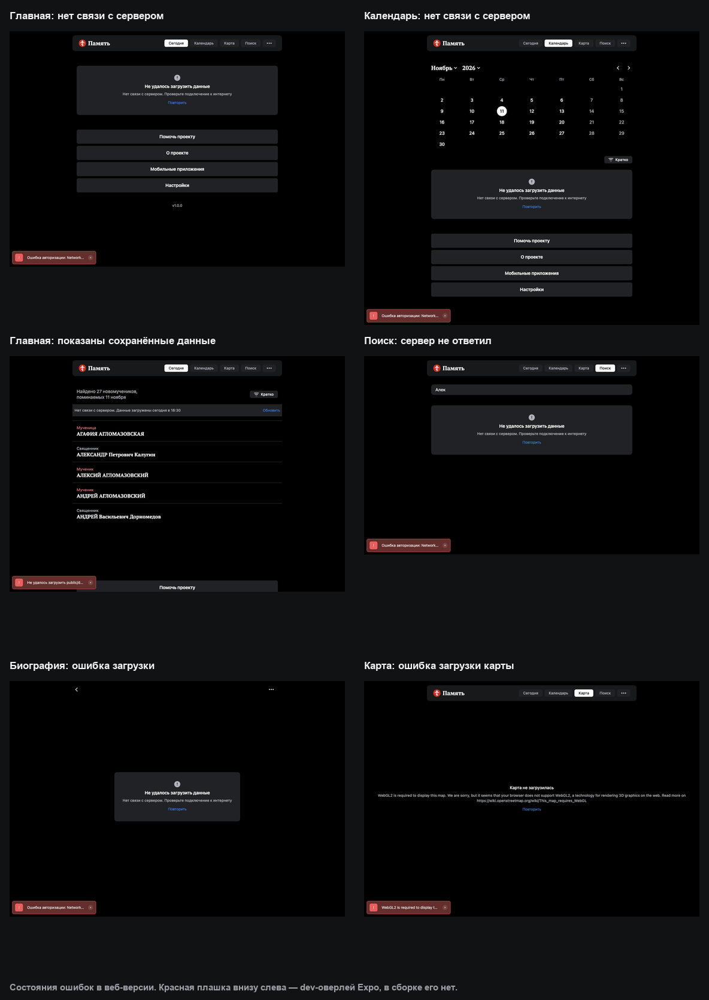

# Состояния ошибок

Плашка ошибки — это `ErrorContent` из `src/components/block-error.tsx`: серый фон,
иконка, заголовок, причина (`describeError`) и кнопка «Повторить».

| Где | Что видно | Нижние кнопки |
| --- | --- | --- |
| Главная, нет связи и нет кэша | Плашка «Не удалось загрузить данные» в ленте, под ней подвал | Да |
| Календарь, нет связи и нет кэша | Плашка под календарём, строка «Найдено …» скрыта | Да |
| Главная / календарь, есть сохранённая копия | Серая полоса `OfflineNotice`: «Нет связи с сервером. Данные загружены …» и «Обновить» | Да |
| Поиск, сервер не ответил | Та же плашка ошибки под полем поиска; на телефоне при доступном офлайн-индексе — серая плашка «Нет связи с сервером, ищем только по ФИО» | Нет (у вкладки нет подвала) |
| Страница новомученика | Полноэкранная плашка `BlockError` по центру; шапка с «назад» и «⋯» остаётся | Нет |
| Карта | `ErrorBoundary`: «Карта не загрузилась», причина, «Повторить» | Нет |
| Настройки, скачивание базы | Строка «Загрузка прервалась: …» в разделе «Скачать базу» | Нет |

## Где это в коде

- `src/components/block-error.tsx` — `ErrorContent` (плашка) и `BlockError` (полный экран).
- `src/components/show-cards.tsx:110` — ошибка списка «Сегодня» и «Календаря».
- `src/app/(tabs)/(today)/index.tsx:50` — при ошибке заголовок с числом скрывается, лента и подвал остаются.
- `src/app/(tabs)/calendar/index.tsx:109` — то же для календаря.
- `src/components/offline-notice.tsx` — полоса «показаны сохранённые данные».
- `src/app/(tabs)/search/index.tsx:92` — ошибка поиска.
- `src/screens/person-page.tsx:396` — ошибка биографии.
- `src/app/(tabs)/map/index.tsx:82` — `ErrorBoundary` карты.
- `src/app/settings.tsx:274` — ошибка скачивания базы.

## Про красную плашку

Красная плашка внизу слева на скриншотах — это dev-оверлей Expo (LogBox), а не
интерфейс приложения. В статической сборке её нет.
